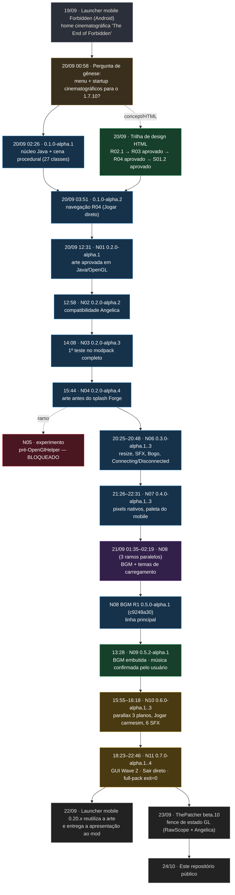

# Cronologia — AkashicCinematicMenu (da origem à 0.7.0-alpha.4)

> Fuso de todos os horários: **America/Sao_Paulo (UTC−03:00)**. Os registros do Codex estão em UTC; aqui já foram convertidos.
> Este documento é a **linha do tempo narrativa**. Os diagramas completos estão em [`FLUXOGRAMA.md`](FLUXOGRAMA.md); os hashes de cada JAR em [`LINEAGE.md`](LINEAGE.md); as lacunas do acervo em [`PROVENANCE.md`](PROVENANCE.md).

## 0. Como ler

| Marca | Significado |
|---|---|
| **[DOC]** | afirmado em documento do projeto (pareceres, READMEs, checkpoints) — ver `docs/reviews/` e `docs/versions/` |
| **[JAR]** | data/tamanho/SHA-256 medidos no arquivo do artefato (mtime do `.jar`) |
| **[LOG]** | registro de sessão do Codex (ChatGPT desktop) recuperado do PC |
| **[INF]** | inferência do documentador — **não** é fato registrado |

Regra do projeto (herdada do `QUALITY_CONTRACT`): **implementado ≠ compilado ≠ testado ≠ aprovado visualmente pelo usuário ≠ homologado em runtime**. Toda linha abaixo diz em qual desses estados o item está.

## 1. Visão geral numa tela

Legenda de cores: azul = compilado e testado em escopo dirigido · verde = aprovado pelo usuário · âmbar = testado, **aprovação visual/sonora do usuário pendente** · vermelho = bloqueado/não promover · roxo = ramo paralelo.

---

## 2. Linha do tempo detalhada

### Fase 0 — Pré-história: o launcher mobile (19/09/2026)

O AkashicCinematicMenu **nasce de uma identidade visual que já existia no app Android "Forbidden Series"** (launcher mobile, então v0.13.3 → 0.14.x), desenvolvido na mesma conta/pasta de trabalho (`Documents\ChatGPT\App Forbidden Series`).

| Quando | Fato | Fonte |
|---|---|---|
| 19/09 13:51 | Sessão-mestra do Codex do app mobile (≈351 MB de log). | [LOG] |
| 19/09 15:19 | Subagente *cinematic_home* reconstrói a `LauncherHomeView.java`: título **The End / Of / FORBIDDEN**, abertura de **6,4 s** (câmera, luz, 26 partículas), ambiente contínuo de **24 s** (halo, cubo, fachos, poeira). | [LOG] |
| 19/09 ≈17:25 | Ícone do app: **anjo encapuzado sem rosto, asas prateadas, halo dourado** — o motivo central que migra para o menu. | [LOG] |
| 19/09 | Pedido do usuário: *"algo cinematográfico… a logo possui um anjo oculto sombrio encapuzado sem rosto… dá pra ver que é só um banner"*. | [LOG] |
| 20/09 01:00 | Stack-alvo, lida pelo Codex no README do launcher: Minecraft Java **1.7.10 + Forge 10.13.4.1614 + TEOF 1.1**, Java 8. | [LOG] |

### Fase 1 — Gênese do menu desktop (20/09/2026 madrugada)

| Quando | Fato | Fonte |
|---|---|---|
| **20/09 00:58:55** | Pergunta de gênese ao Codex: *"seria possível criar um Main Menu e Tela de Inicialização customizada, com animations, effects, parallax, 3d, transitions, opacity… para o nosso 1.7.10?"* | [LOG] sessão `01a0bcf6` |
| 20/09 01:00 | Resposta: **sim** — Forge 1.7.10 permite substituir o menu; **a inicialização exige integração separada** (o carregamento usa thread e contexto gráfico próprios). | [LOG] |
| 20/09 01:08–01:11 | Perguntas "em 4K sem perder qualidade?" e "e cores?": plano de PNG sem perdas, sRGB, camadas separadas para parallax, texto na resolução final, cuidado com banding. | [LOG] |
| 20/09 ~01:11 → 02:19 | **Lacuna documentada.** A conversa de ChatGPT em que o trabalho prossegue (concept, HTMLs, pacote de fonte) **não está no disco**; só restam seus artefatos. | [INF] — ver `PROVENANCE.md` |
| 20/09 02:19 | Primeiros arquivos de `src/` (núcleo: `Tween`, `MenuFlow`, `Easing`, …) e testes do núcleo. | [DOC] mtimes |
| 20/09 02:26 | **0.1.0-alpha.1** — JAR de 28.132 B, 27 classes Java 8; núcleo 44 cenários / 17.538 asserções; compilado contra APIs reais; **não homologado no jogo**. SHA-256 `6d7f5b0a…`. | [JAR][DOC] |
| 20/09 02:28 | `CHECKPOINT.json` **ACM-2026-09-20-ALPHA1** (histórico, nunca sobrescrito). | [DOC] |
| 20/09 02:50 | **`QUALITY_CONTRACT.md` (ACM-QUALITY-2026-09-20-v1)** — a "regra cardinal". O último HTML (estátua em Three.js) foi **reprovado visualmente** pelo usuário; a concept da *catedral brutalista* (navegação à esquerda 25–30 %, anjo sem rosto à direita, verde eco-brutalista) vira a referência. | [DOC] |

### Fase 2 — Trilha de design em HTML (20/09/2026)

Laboratório visual em HTML; **não é** o mod. Os HTMLs foram entregues na conversa do ChatGPT; só **R02 (base)** e **R03** existem no PC (ver `docs/design/R03/`).

| Rodada | Quando | Resultado | Hash do HTML |
|---|---|---|---|
| R02.1 — Santuário / Obelisco / Véu | 20/09 03:08 | 3 variações; 187 verificações no Chromium; aprovação pendente na época | `32fdf021…` (1.036.846 B) |
| **R03** — Santuário (painel B) | 20/09 (entre 03:08 e 03:54) | **Aprovada pelo usuário**: *"Ficou muito bom, vamos deixar assim."* Snapshot local gravado às 06:30–06:34. | `dist/Forbidden-Santuario-R03.html` (702.189 B) |
| **R04** — navegação | 20/09 03:54 | Aprovada. Quatro ações: **Jogar** (conexão direta `br2.xmxcloud.net:10511`), **Singleplayer**, **Opções**, **Sair**. Removidos *Mods* e *Multiplayer*. | `61be2364…` (702.244 B) — *não está no PC* |
| **S01.2** — *O Despertar* (startup) | 20/09 04:18 | Aprovada ("O Despertar S01.2 aprovado" → autoriza a produção nativa). | `c0158907…` (1.466.201 B) — *não está no PC* |

### Fase 3 — Integração nativa N01–N04 (20/09/2026, tarde)

| Versão | Hora [JAR] | O que mudou / provou | SHA-256 (início) |
|---|---|---|---|
| **0.1.0-alpha.2** (`navigation-r04`) | 03:51 | Rota *Jogar* verificada no bytecode (`setupServerList` → `FMLClientHandler.connectToServer`); 48 cenários / 17.489 asserções. Arte ainda procedural. | `c8930796…` |
| **N01 0.2.0-alpha.1** | 12:31 | Arte aprovada (52 ativos) desenhada em **Java/OpenGL**, sem navegador em runtime; probe OpenGL real (Intel UHD, GL 4.6): 511 verificações. **Ensaio do transformer bloqueado pela ferramenta.** Não liberada. | `7e5c5b23…` |
| **N02 0.2.0-alpha.2** | 12:58 | Retira a exclusão do pacote `render` do transformer, permitindo a emulação gráfica do **Angelica** (N01 falhava no contexto core do Angelica). | `377e842e…` |
| **N03 0.2.0-alpha.3** | 14:08 | **Primeira execução no modpack completo** (cópia isolada `qa-n02`). Defeito reproduzido (run03): *canal de conexão aberto >10 s após cancelar*; corrigido com vigilância limitada. Run04 exit=0: 35 + 7 + 16 verificações. Pendência: latência de minimizar/foco (8,5 s). | `154c9504…` |
| **N04 0.2.0-alpha.4** | 15:44 (zip certificado 15:52) | Hook **depois de `OpenGlHelper.initializeTextures`**: a arte aparece antes do splash do Forge. 1ª arte visível: **7,479 s (N03) → 2,432 s (N04)** (medição pontual). Foco medido direto no HWND: 6 ciclos, 101–406 ms. Run08: 12 verificações de fallback com imagens ausentes. 898 arquivos do pack original intactos. | `3adfd2cc…` |
| *Retomada N04* | 16:17 | O pack diário divergia do manifesto (20 hashes; JAR extra `akashicindex-tablet-music-online-r2.jar`). Registrado, **não** sobrescrito. | — |

### Fase 4 — N05, experimento bloqueado (20/09, ≈14:47)

Tentativa de renderizar **antes** do `OpenGlHelper` usando só pipeline programável. A gravação do script de integração foi **bloqueada pela camada de ferramentas**; a estratégia foi interrompida **sem contornar o bloqueio**. Fontes parciais, **sem build nem runtime**. **Nunca promover** (`do_not_promote` em `CURRENT_STATUS.json`). No git: branch `experiment/n05-blocked`.

### Fase 5 — N06 e N07 (20/09/2026, noite)

| Versão | Hora [JAR] | Destaques |
|---|---|---|
| **N06 0.3.0-alpha.1** | 20:25 | Redimensionamento do splash, SFX de UI, aviso Bogo/InventoryTweaks específico, telas Connecting/Disconnected. **Reprovada em runtime** (run `n06run1`): `IllegalAccessError` — classe `LateBogoNoticeGate` package-private chamada pelo adaptador de eventos do Forge. |
| N06 0.3.0-alpha.2 | 20:38 | Listener tornado público + gate de acessibilidade em bytecode; mensagem *Disconnected* excedia o cartão → alpha.3. |
| **N06 0.3.0-alpha.3** | 20:48 | Base da N07. Análise do resize/SFX em `docs/research/analysis-resize-sfx-20260920/`. |
| **N07 0.4.0-alpha.1** | 21:26 | Compositor responsivo por pixels do framebuffer (remove o "corredor" lateral de ~70 px em 1920×1001), tipografia em atlas, **paleta do launcher mobile** (`#090D14 #171C25 #E8E4D8 #C4AA7C #ACB2BB #DCEBFA`). Reprovada visualmente: metadados de 5–7 px ilegíveis. |
| N07 0.4.0-alpha.2 | 21:33 | Mínimos 9 px / 12 px + reticências. |
| **N07 0.4.0-alpha.3** | 22:31 | Corrige moldura sobre o último rodapé (95,5 %→97,5 %). `n07release2`: **34 + 10 + 20** verificações, exit=0. **Risco aberto:** `n07release` encerrou cedo com `exit=1`, **causa nunca estabelecida**. Descoberta de método: `Display.setDisplayMode` destrói/recria a janela nativa (HWND velho invalidava os testes de pausa). |

### Fase 6 — N08: três ramos em paralelo e a BGM (21/09/2026, madrugada)

Em ~45 minutos surgiram **três** artefatos N08 a partir da N07 (provável sobreposição de sessões — **[INF]**):

| Ramo | JAR [JAR] | SHA-256 (início) | Observação |
|---|---|---|---|
| `native-n08` (parcial) | 01:35 · 0.5.0-alpha.1 | `9d1fa4e1…` | Interrompido por *timeout*; `MenuBgm.java` ficou com 30 linhas. **Mesmo rótulo de versão** que o R1 (cuidado!). |
| `native-n08-bgm-6c79c577` | 01:40–02:19 · 0.5.1-alpha.1..3 | `2de7bd9a…` / `ee22b716…` / `4f12227f…` | QA própria (`qa-n08-bgm-6c79c577`); inclui rota de carregamento do **Et Futurum** e guarda de namespace para a música vanilla `minecraft:music.menu` (rotulada `RECORDS`). |
| **`native-n08-bgm-r1`** | 01:41 · **0.5.0-alpha.1** | `c9248a30…` | **Linha principal.** 73 classes; 15 verificações de runtime (renderizadores Aether e vanilla); **sem a faixa** dentro do JAR (teste só de fallback). |

Fato sobre a música: o usuário forneceu `BGM.mp3` (SHA-256 `1e7a442d…`, 6.475.232 B); o artista pedido era *"Fluxxwave (Slowed + Reverb)"* e o registro do projeto já anotava **"não baixar/ripar nem substituir gravação; o motor pode ser construído sem a faixa protegida"**. → **A faixa é de terceiros e não está neste repositório.**

### Fase 7 — N09: entrega e exclusividade da BGM (21/09, 13:28)

* Diagnóstico da instalação diária: JAR `0.5.0-alpha.1` **sem** a gravação, `options.txt` com **Música = 0 %** (mute intencional respeitado), `latest.log` confirmando recurso ausente.
* **0.5.2-alpha.1** (`da5bb557…`, 11,5 MB): gravação **embutida** (Ogg/Vorbis em streaming, SHA do áudio `6e91e747…`); filtro de música alheia (categoria `MUSIC` de outros mods + IDs `minecraft/music.*` e `aether_legacy/music.*` mesmo se rotulados `RECORDS`), só no frontend fora de mundo.
* **O usuário confirmou a música como funcional** → N09 é a **linha de base confirmada** (`user_confirmed_baseline`).

### Fase 8 — N10: produção cerimonial (21/09, 15:55–16:18)

* **0.6.0-alpha.3** (`a15e18a2…`, 77 classes): botão **Jogar** carmesim/branco (brilho de borda, respiração, faixa de luz, pressão de 220 ms — sem tocar a área clicável); cenário em **3 profundidades** (céu / arquitetura / anjo+halo) mais **máscara de ocultação**; **6 SFX sintetizados** de inspiração "catedral" (coro sem palavras, metal ressonante — *não* canto gregoriano gravado).
* 276 verificações do renderizador (pbuffer privado, Intel UHD, 5 resoluções), 4.807 de câmera/animação; faixa de brilho reprovada (marcas entre segmentos) e substituída por faixa contínua.
* **Não foi executada no modpack completo** (havia clientes Java do usuário abertos e só 1–2 GiB livres).

### Fase 9 — N11: GUI Wave 2 (21/09, 18:23–22:46) — *último estado*

* **0.7.0-alpha.4** (`7dbf5177…`, 81 classes, 16.508.324 B): identidade do Santuário estendida a Options, Select World, Create World (+ aviso do **RTG**), Language, Resource Packs, Controls, Video (**Reese Sodium** no pack real), Sound, Chat, Snooper, Flat World/Presets, Rename World e confirmações vanilla.
* **Sair** no menu principal passa a **encerrar direto** (sem `GuiYesNo`); confirmações destrutivas (apagar mundo) **preservadas**.
* 13 *gates* independentes aprovados; **cliente completo exit=0**, 83 checagens funcionais, BGM contínua pelos submenus, zero erros GL, nenhum mundo aberto, nenhuma conexão.
* Dois registros de falha esperados e preservados: o 1º gate de QUIT rodou com janela inativa (a própria política do menu cancelou a transição); repetido com *foreground* real → exit=0.
* Status oficial: `FULL_PACK_DIRECTED_TESTS_PASSED__USER_VISUAL_APPROVAL_PENDING`.

### Fase 10 — Depois da 0.7.0-alpha.4

| Quando | Fato | Fonte |
|---|---|---|
| 22/09 17:39 | O launcher mobile (Forbidden **0.20.8 / versionCode 64**) "utiliza a arte do próprio AkashicCinematicMenu e **entrega a apresentação ao mod** após confirmar atividade gráfica real". | [LOG] |
| 21/09 (durante a N11) | Pasta diária do PC observada (somente leitura) com a **N10 (0.6.0-alpha.3)**; a N11 **não** foi instalada por este fluxo. | [DOC] |
| **23/09 17:14** | No cliente real, o `RawScope` do menu é reescrito pelo **Angelica 2.2.18** (2.559 → 2.646 B). Hipótese forte para o sintoma de **blocos brancos**: `glPushAttrib(GL_ALL_ATTRIB_BITS)` + redirecionamento do GLSM dessincroniza `GL_TEXTURE_2D`. | [DOC] ThePatcher |
| 23/09 | **ThePatcher 1.1.0-beta.10-Cinematic-Angelica** (`3182e7e3…`) injeta um *state fence* após o `RawScope.close()` da alpha.4 e protege o `applyVSyncMode` do Angelica. Candidato técnico PASS; **aceitação em GPU/cliente real pendente.** | [DOC] |
| 24/10 | Este repositório é montado a partir do acervo local (ver `PROVENANCE.md`). | — |

---

## 3. Placar de evidência por versão (o que cada parecer *afirmou* ter executado)

| Versão | Classes | Núcleo | Outros gates | Runtime no pack |
|---|---|---|---|---|
| 0.1.0-alpha.1 | 27 | 44 cen. / 17.538 asserç. | — | não |
| 0.1.0-alpha.2 | — | 48 / 17.489 | rota no bytecode | não |
| 0.2.0-alpha.1 (N01) | 37 | 48 / 17.489 | probe GL: 511 | não |
| 0.2.0-alpha.3 (N03) | 41 | 48 / 17.489 + 15 conexão | run04: 35+7+16 | **sim** (exit=0) |
| 0.2.0-alpha.4 (N04) | 43 | idem | runs06/07: 46 + 6 foco; run08: 12 falha | **sim** (exit=0) |
| 0.4.0-alpha.3 (N07) | 56 | idem + geometria 1.785, UI 140, glyphs 2.016 | n07release2: 34+10+20 | **sim** (exit=0) |
| 0.5.0-alpha.1 (N08 R1) | 73 | + fade 1.557, lifecycle 18/124 | 15 runtime (sem faixa) | parcial |
| 0.5.2-alpha.1 (N09) | — | + classificação sonora 32 | — | usuário confirmou música |
| 0.6.0-alpha.3 (N10) | 77 | + câmera/animação 4.807 | 276 (pbuffer) | **não** |
| **0.7.0-alpha.4 (N11)** | **81** | **+ política secundária 58** | **13 gates + 83 runtime** | **sim** (exit=0) |

> As contagens incluem pré-condições e verificações repetidas; os próprios pareceres avisam que **não** equivalem a "classes independentes de defeitos".

## 4. Decisões estruturais (mini-ADRs)

1. **Cena nativa em Java/OpenGL, sem navegador em runtime** (N01). HTML só como laboratório de design.
2. **Fail-open em tudo**: cada transformer ASM conta âncoras exatas e, se a forma do bytecode divergir, **devolve a classe original** e registra no log.
3. **Hook antecipado após `OpenGlHelper.initializeTextures`** (N04) em vez de tentar desenhar antes do contexto gráfico (N05, descartado).
4. **Sem `sleep`, sem percentual fictício, sem thread nova** no splash: progresso real do `ProgressManager` do Forge ou "Preparando o ambiente" indeterminado.
5. **Pacote `render` fora da exclusão de transformers** (N02) para o Angelica redirecionar o GL — consequência estudada na ThePatcher beta.10.
6. **BGM por `SoundHandler`**, categoria `MUSIC`, respeitando `MUSIC`/`MASTER`; nunca "consertar" o mute do usuário (N08/N09).
7. **Tema só por allow-list exata de classes** (N11); GUIs desconhecidas de outros mods permanecem intactas.
8. **QA sempre em cópia isolada do modpack**; o pack diário nunca é alterado pelo fluxo de desenvolvimento.
9. **Autorrevisão ≠ auditoria independente; aprovação do usuário é separada** (QUALITY_CONTRACT).
