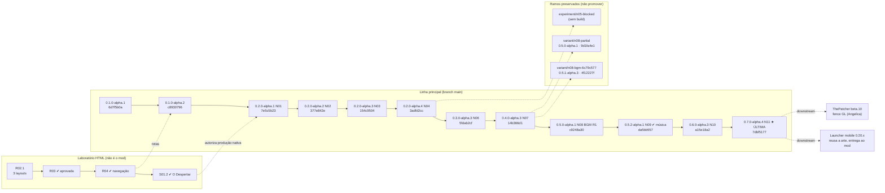
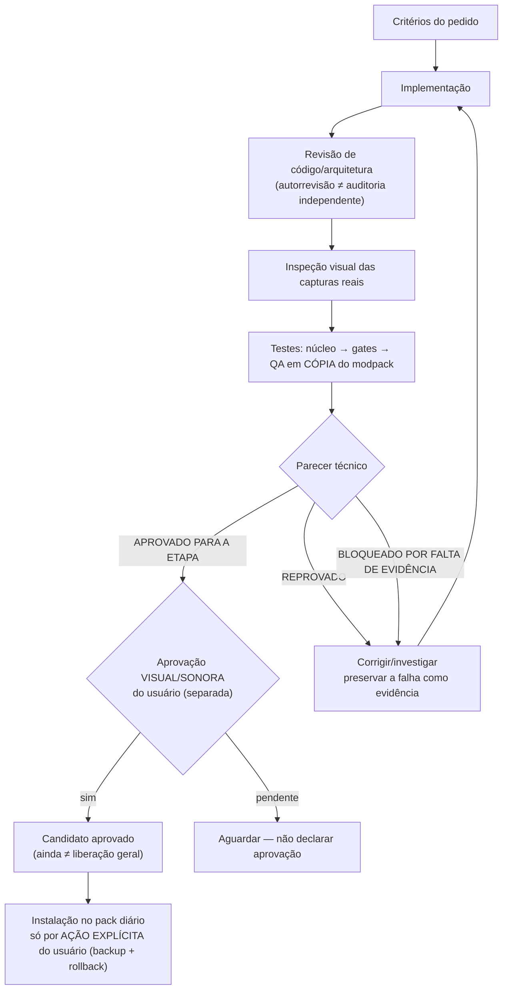
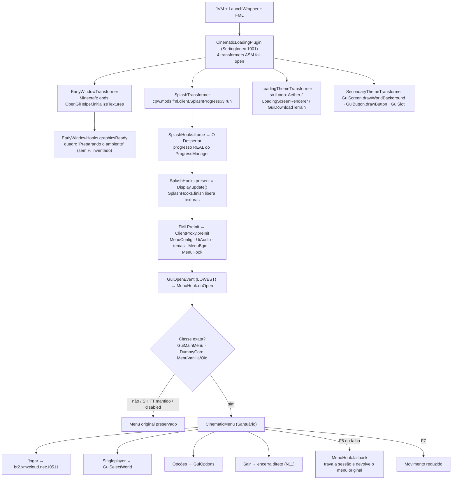
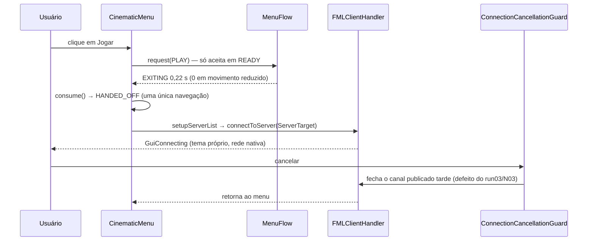
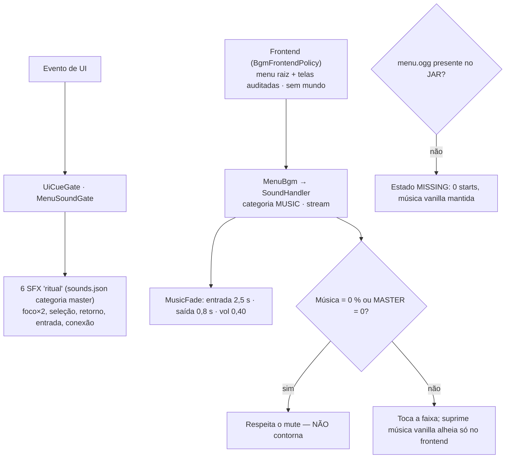
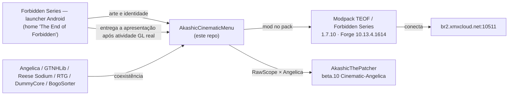

# Fluxogramas — AkashicCinematicMenu

Todos os diagramas são Mermaid (renderizam direto no GitHub). Complementam [`CRONOLOGIA.md`](CRONOLOGIA.md).

## 1. Linhagem de versões (espelha os branches e tags do git)

## 2. Fluxo de trabalho/governança (QUALITY_CONTRACT)

Estados que **nunca** se herdam entre versões: código escrito · compilado · testado · aprovado pelo usuário · homologado em runtime.

## 3. Fluxo de boot e substituição de telas (0.7.0-alpha.4)

## 4. Fluxo "Jogar" (conexão direta)

## 5. Árvore de áudio (BGM e SFX)

## 6. Ecossistema

